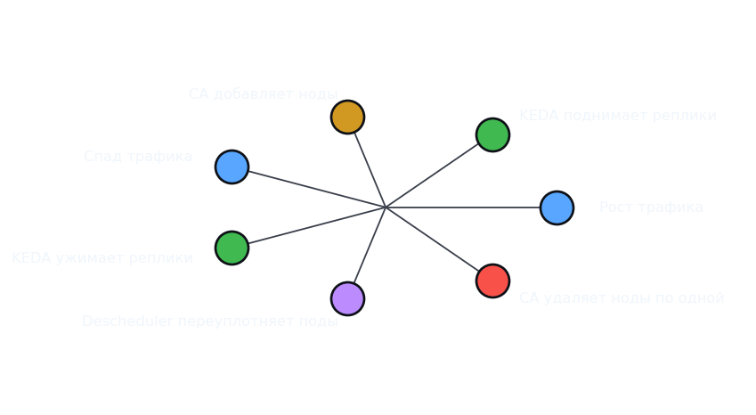
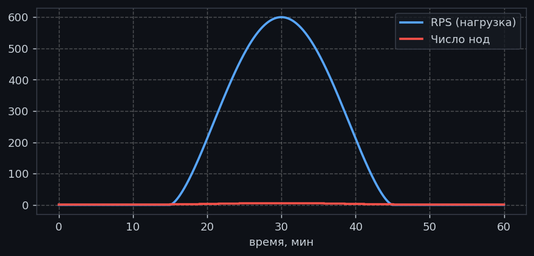
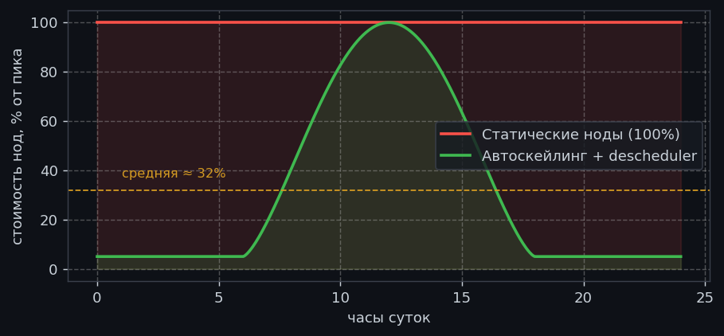

# Плавное удаление k8s нод по одной при снижении трафика: descheduler + Cluster Autoscaler

Знакомая картина: в кластере Kubernetes живут бизнес-сервисы, нагрузка на которые днём растёт до пика, а ночью падает почти до нуля. При росте трафика Kubernetes хорошо умеет масштабироваться вверх: KEDA (или HPA) поднимает реплики, Cluster Autoscaler добавляет ноды. А вот с обратным движением всё хуже — когда трафик спадает, число реплик сокращается, но ноды остаются стоять полупустыми и продолжают стоить денег. Cluster Autoscaler удаляет ноды далеко не сразу: ему нужно, чтобы нода была [незагружена](https://github.com/kubernetes/autoscaler/blob/master/cluster-autoscaler/FAQ.md#how-does-scale-down-work). Непустые ноды Cluster Autoscaler удаляет [по одной за раз](https://github.com/kubernetes/autoscaler/blob/master/cluster-autoscaler/FAQ.md#how-does-scale-down-work), а пустые — пачкой до 10.

Выход — добавить в связку **descheduler**: компонент, который выселяет поды с недозагруженных нод и уплотняет их на оставшихся, чтобы Cluster Autoscaler увидел пустые ноды и удалил их **по одной**, аккуратно и без простоев. В этой статье разберём, как устроен этот цикл «вниз», и развернём демо-стенд, на котором своими глазами видно, как ноды схлопываются одна за другой при спаде трафика.

## Почему ноды не удаляются сами по себе

Прежде чем добавлять descheduler, поймём, почему одного Cluster Autoscaler недостаточно. Cluster Autoscaler удаляет ноду, только когда **все** условия выполнены одновременно:

1. **Суммарные `resources.requests` подов на ноде меньше 50%** от ресурсов ноды, доступных для размещения подов (allocatable — ёмкость ноды за вычетом резерва под систему и kube-агенты).
2. **Все поды можно перенести** на другие ноды. Не переносятся: поды без контроллера (голые Pod'ы), поды с локальным хранилищем (`emptyDir`, `hostPath`), поды, которым мешает PodDisruptionBudget, поды с ограничениями планировщика, которые не помещаются больше нигде (в том числе поды с PVC `ReadWriteOnce`, привязанным к зоне/ноде).
3. Нода находится в таком состоянии **не менее 10 минут** (`--scale-down-unneeded-time`).

И главное для нашей темы: **непустые ноды CA удаляет строго по одной за раз** ([документация](https://github.com/kubernetes/autoscaler/blob/master/cluster-autoscaler/FAQ.md#how-does-scale-down-work)), чтобы не создать волну unschedulable-подов. Пустые ноды он может удалять пачкой (до 10 сразу).

Проблема в пункте 1 и 2: после того как KEDA ужал реплики, поды остаются лежать по одной-две штуки на каждой ноде. Каждая такая нода — с парой подов, utilisation ниже 50% — уже кандидат на удаление, но CA тратит время на проверку переносимости каждого пода и удаляет по одной с задержками. А иногда под с PVC или PDB «якорит» ноду навсегда. descheduler решает именно это: он **сам** выселяет поды с недозагруженных нод, освобождая их для CA.

## Как это работает: три компонента в связке

Полный цикл «спад трафика → меньше нод» — это результат работы трёх независимых компонентов:

**1. KEDA (или HPA) снижает число реплик.** Метрика RPS падает, KEDA пересчитывает желаемое число реплик и ужимает Deployment. Ноды, на которых эти реплики жили, становятся недозагруженными. Это триггер всего цикла: без автоскейлинга приложения ноды не «проседают» по нагрузке.

**2. Descheduler уплотняет поды.** Плагин `HighNodeUtilization` находит ноды, занятые по cpu/memory/pods **ниже порога** (в демо — 20%), и выселяет с них поды через Eviction API. Выселенные поды переезжают на оставшиеся ноды, а освободившиеся — пустеют. Важно: descheduler сам ничего не планирует, он полагается на обычный kube-scheduler, который расставляет выселенные поды заново.

**3. Cluster Autoscaler удаляет пустые ноды.** Как только нода опустела, условия из прошлого раздела выполняются тривиально: utilisation 0%, переносить нечего. CA удаляет её. Непустые ноды он по-прежнему удаляет по одной — это и даёт то самое «плавное» схлопывание без рывков.

Получается замкнутый цикл:



Рост трафика идёт в обратную сторону: KEDA поднимает реплики → они не помещаются → CA добавляет ноды. А наш демо-стенд показывает обе фазы в одном прогоне.

## Как это настроить

Настройка состоит из двух частей: политика descheduler и сам цикл автоскейлинга приложения.

> **Значения в примерах — не константы, а отправная точка.** Пороги descheduler (`thresholds`), `threshold` в RPS на реплику, `resources.requests` бизнес-приложения, профиль нагрузки генератора (`MIN_RPS`/`MAX_RPS`/`CYCLE`) и размер нод вы выставляете сами под своё приложение. В демо мы взяли ноду 2 vCPU / 4 ГБ, `threshold` = 25 RPS/реплику и запросы 250m CPU / 250Mi как разумные стартовые значения.

### Шаг 1. Настройте Cluster Autoscaler

В Yandex Managed K8s Cluster Autoscaler включается прямо в node group — отдельная установка не нужна:

```hcl
resource "yandex_kubernetes_node_group" "k8s_node_group" {
  cluster_id = yandex_kubernetes_cluster.descheduler.id

  scale_policy {
    auto_scale {
      min     = 1 # Ночью кластер схлопывается до одной ноды
      max     = 5 # Дневной пик — до пяти нод
      initial = 1
    }
  }
  # ...
}
```

### Шаг 2. Установите descheduler с политикой HighNodeUtilization

Ключевой фрагмент — политика. Плагин `HighNodeUtilization` выселяет поды с нод, занятых **ниже** порога `thresholds` (по cpu, memory и pods), и они уплотняются на остальных нодах:

```yaml
deschedulerPolicy:
  profiles:
    - name: default
      pluginConfig:
        - name: HighNodeUtilization
          args:
            thresholds:
              cpu: 20     # нода считается «пустой», если занято < 20% CPU
              memory: 20   # ... и < 20% памяти
              pods: 20     # ... и < 20% от ёмкости по числу подов
        - name: DefaultEvictor
          args:
            ignorePvcPods: true   # защитить поды с PVC от выселения (Redis не должен переезжать)
      plugins:
        balance:
          enabled:
            - HighNodeUtilization
```

Установка через helm CLI:

```bash
helm repo add descheduler https://kubernetes-sigs.github.io/descheduler/
helm upgrade --install descheduler descheduler/descheduler \
  --namespace kube-system --version 0.36.0 \
  --set kind=CronJob \
  --set schedule="*/2 * * * *" \
  --set image.tag=v0.36.0 \
  --set-json 'deschedulerPolicy={"profiles":[{"name":"default","pluginConfig":[{"name":"HighNodeUtilization","args":{"thresholds":{"cpu":20,"memory":20,"pods":20}}},{"name":"DefaultEvictor","args":{"ignorePvcPods":true}}],"plugins":{"balance":{"enabled":["HighNodeUtilization"]}}}]}'
```

> **Почему CronJob, а не Deployment.** Descheduler — это периодическая «уборка», а не постоянно работающий сервис: он отработал, выселил поды и завершился. Запуск CronJob'ем каждые 2 минуты — стандартный режим из официального чарта. Демо-стенду этого достаточно, а в проде интервал подбирайте так, чтобы не гонять лишние eviction'ы и не нагружать API-сервер.

> **Нюанс про MostAllocated.** Чтобы уплотнение было устойчивым, kube-scheduler должен ставить поды по стратегии `NodeResourcesFit` + `MostAllocated` (жадно заполнять ноды), иначе выселенные поды планировщик разложит обратно по принципу «поровну» (`LeastAllocated`). В Yandex Managed K8s конфиг kube-scheduler провайдер не меняет — там LeastAllocated по умолчанию. Поэтому в демо descheduler работает в связке со scale-down'ом CA: он освобождает ноды, а CA их удаляет, не дожидаясь идеальной упаковки.

### Шаг 3. Разверните приложение Helm-чартом

Демо-приложение — Helm-чарт [chart/](chart/), в котором собраны все типовые контроллеры, чтобы показать, как каждый ведёт себя при удалении нод:

| Ресурс | Что делает | Поведение при scale-down |
|---|---|---|
| **Deployment** `business-app` | бизнес-API, масштабируется по RPS | реплики переносятся, ноду можно удалить |
| **DaemonSet** `node-agent` | агент на каждой ноде (heartbeat в лог) | под daemon-а не мешает удалению пустой ноды — CA удаляет его вместе с нодой |
| **StatefulSet** `redis` | Redis с PVC (1 ГБ) | **якорит** свою ноду: RWO-PVC не переносится, нода не удаляется |
| **CronJob** `cron-job` | раз в 5 минут пишет метку в Redis | под Job'а не блокирует удаление ноды |
| **Deployment** `worker` | фоновый воркер, считает задания в Redis | как обычный Deployment — переносится |

Кроме контроллеров, чарт сразу вешает на `business-app` два механизма, без которых «плавное» схлопывание превращается в потерю запросов: **PodDisruptionBudget** (по умолчанию `minAvailable: 1`) и **graceful shutdown** (`terminationGracePeriodSeconds: 30`, обработка SIGTERM в Go). Подробно оба механизма и два демо-сценария разобраны в разделе «[PDB и graceful shutdown при схлопывании нод](#pdb-и-graceful-shutdown-при-схлопывании-нод)».

Исходники Go-приложений — в [apps/](apps/), образы собираются GitHub Actions ([.github/workflows/docker.yml](.github/workflows/docker.yml)) и публикуются в GHCR.

```bash
helm install demo ./chart
```

### Шаг 4. Подключите KEDA-триггер по RPS

`ScaledObject` ([manifests/keda/scaledobject.yaml](manifests/keda/scaledobject.yaml)) масштабирует `business-app` по метрике из VictoriaMetrics:

```yaml
apiVersion: keda.sh/v1alpha1
kind: ScaledObject
metadata:
  name: business-app
spec:
  scaleTargetRef:
    name: demo-app-business-app
  minReplicaCount: 1   # ночью держим одну реплику
  maxReplicaCount: 60  # потолок под пик 600 RPS
  triggers:
  - type: prometheus
    metadata:
      serverAddress: http://vmsingle-vmks-victoria-metrics-k8s-stack.vmks.svc.cluster.local:8428
      query: |
        sum(rate(business_app_http_requests_total{route="root"}[1m]))
      threshold: "25"          # одна реплика обслуживает ~25 RPS
      activationThreshold: "3" # ниже 3 RPS реплики не поднимаем
```

```bash
kubectl apply -f manifests/keda/scaledobject.yaml
kubectl apply -f manifests/keda/vmservicescrape.yaml
```

<!-- TODO: найти видео или gif в интернете, показывающее схлопывание нод descheduler'ом + CA (scale-down по одной), и вставить в раздел «Демо». Поиск (DuckDuckGo: descheduler kubernetes scale down gif/demo) готовой гифки именно про downscale не дал — есть только общие Kubernetes-стикеры на GIPHY. -->

## Демо: наблюдаем схлопывание нод

### Шаг 0. Разворачиваем кластер

Инфраструктура поднимается Terraform'ом — детали в [INFRASTRUCTURE.md](INFRASTRUCTURE.md): Yandex Managed K8s с node group в автоскейлинге (1–5 нод), ноды без публичных IP, NAT-шлюз для исходящего трафика, Traefik. Descheduler ставится вручную через helm CLI (шаг 1).

```bash
export TF_VAR_folder_id=<folder-id>   # каталог Yandex Cloud, в котором создаётся стенд
terraform init
terraform apply
yc managed-kubernetes cluster get-credentials --id $(terraform output -raw k8s_cluster_id) --external --force
```

Требуется установленный стек VictoriaMetrics (KEDA берёт RPS из vmsingle) — команда установки в [AGENTS.md](AGENTS.md).

### Шаг 1. Ставим descheduler

Terraform descheduler не устанавливает — ставим вручную через helm CLI:

```bash
helm repo add descheduler https://kubernetes-sigs.github.io/descheduler/
helm upgrade --install descheduler descheduler/descheduler \
  --namespace kube-system --version 0.36.0 \
  --set kind=CronJob \
  --set schedule="*/2 * * * *" \
  --set image.tag=v0.36.0 \
  --set-json 'deschedulerPolicy={"profiles":[{"name":"default","pluginConfig":[{"name":"HighNodeUtilization","args":{"thresholds":{"cpu":20,"memory":20,"pods":20}}},{"name":"DefaultEvictor","args":{"ignorePvcPods":true}}],"plugins":{"balance":{"enabled":["HighNodeUtilization"]}}}]}'
```

### Шаг 2. Ставим KEDA

```bash
helm repo add kedacore https://kedacore.github.io/charts
helm install keda kedacore/keda --namespace keda --create-namespace --version 2.20.2
```

### Шаг 3. Ставим приложение и KEDA-триггер

Разворачиваем Helm-чарт и подключаем ScaledObject со сбором метрик:

```bash
helm install demo ./chart
kubectl apply -f manifests/keda/scaledobject.yaml
kubectl apply -f manifests/keda/vmservicescrape.yaml
```

```bash
$ kubectl get pods -o wide
NAME                                READY   STATUS    NODE
demo-app-business-app-...-1         1/1     Running   ...-a
demo-app-redis-0                    1/1     Running   ...-a
demo-app-worker-...                 1/1     Running   ...-a
demo-app-node-agent-...             1/1     Running   ...-a
```

### Шаг 4. Запускаем генератор нагрузки

Генератор ([manifests/keda/load-generator.yaml](manifests/keda/load-generator.yaml), исходники [apps/load-generator/](apps/load-generator/)) гоняет `business-app` по гладкой S-образной кривой: за цикл `CYCLE` (30 минут) RPS плавно растёт с 0 до 600, а затем **симметрично спадает** обратно к 0 — моделируя дневной подъём и ночной спад:

```bash
kubectl apply -f manifests/keda/load-generator.yaml
```

### Шаг 5. Рост: KEDA поднимает реплики, CA добавляет ноды

Следим за HPA и нодами:

```bash
$ kubectl get hpa keda-hpa-business-app -w
$ kubectl get nodes -w
```

По мере роста RPS KEDA доводит число реплик до 24 (пик 600 RPS / 25 на реплику), а Cluster Autoscaler разворачивает ноды — вплоть до `max = 5`:

```bash
$ kubectl get nodes
NAME                       STATUS   ROLES    AGE
cl1...-uxyz                 Ready    <none>   25m
cl1...-uabc                 Ready    <none>   18m
cl1...-wxyz                 Ready    <none>   12m
cl1...-vdef                 Ready    <none>   7m
cl1...-vghi                 Ready    <none>   2m    ← пик: 5 нод
```

### Шаг 6. Спад: descheduler освобождает ноды, CA удаляет по одной

После пика RPS идёт вниз, KEDA ужимает реплики до 1. Теперь в дело вступает descheduler: он выселяет «одинокие» поды с недозагруженных нод (ниже 20% по cpu/memory/pods) и уплотняет их на остальных. Освободившиеся ноды CA удаляет — **непустые по одной, с интервалом**:

```bash
$ kubectl get events --sort-by=.lastTimestamp | grep -E 'Descheduled|ScaleDown'
LAST SEEN   TYPE      REASON              OBJECT                        MESSAGE
1m          Normal    HighNodeUtilization pod/demo-app-business-app-...  Descheduled: pod eviction from cl1...-vdef node by sigs.k8s.io/descheduler
2m          Normal    ScaleDown           node/cl1...-wxyz              node removed by cluster autoscaler
3m          Normal    ScaleDown           node/cl1...-vdef              node removed by cluster autoscaler
```

Последовательность событий хорошо видна по числу нод:

```bash
$ kubectl get nodes -w
NAME                       STATUS   ROLES    AGE
cl1...-uxyz                 Ready    <none>   31m
cl1...-uabc                 Ready    <none>   24m
cl1...-wxyz                 Ready    <none>   18m
cl1...-vdef                 Ready    <none>   13m
cl1...-vghi                 Ready    <none>   8m
cl1...-vdef                 Ready,SchedulingDisabled   <none>   13m   ← CA cordon
cl1...-vghi                 Ready,SchedulingDisabled   <none>   8m
cl1...-vdef                 Terminating                 <none>   13m
cl1...-vghi                 Terminating                 <none>   8m
cl1...-uxyz                 Ready    <none>   35m   ← кластер схлопнулся
cl1...-uabc                 Ready    <none>   28m
```

В конце остаются две ноды: одна держит Redis с PVC (её CA не тронет — подробнее ниже), вторая — бизнес-поды. При `min = 1` и отсутствии Redis кластер схлопнулся бы до одной ноды.

Визуально цикл выглядит так:



### Наблюдение в Grafana

**RPS бизнес-приложения** — метрика, на которую смотрит KEDA-триггер:

```promql
sum(rate(business_app_http_requests_total{route="root"}[1m]))
```

**Реплики HPA** — текущее и желаемое количество реплик:

```promql
kube_horizontalpodautoscaler_status_current_replicas{horizontalpodautoscaler="keda-hpa-business-app", namespace="default"}
kube_horizontalpodautoscaler_status_desired_replicas{horizontalpodautoscaler="keda-hpa-business-app", namespace="default"}
```

**Число нод** — как кластер следует за нагрузкой:

```promql
count(kube_node_status_condition{condition="Ready", status="true"})
```

## Важные нюансы для корректной работы

Ниже — сводка типовых проблем, из-за которых удаление одной ноды либо не происходит вовсе, либо ломает сервис:

| Проблема | Что произойдёт при удалении ноды | Как исправить |
|---|---|---|
| **Нет graceful shutdown** (приложение не обрабатывает SIGTERM, нет preStop-hook) | Kubelet шлёт SIGTERM и ждёт `terminationGracePeriodSeconds` (30с по умолчанию), затем убивает SIGKILL. Недообработанные запросы обрываются, клиент получает 5xx, пропадают in-flight операции | Обрабатывать SIGTERM в приложении (`http.Server.Shutdown` и т.п.), при необходимости добавить preStop-hook для слива трафика и увеличить `terminationGracePeriodSeconds` |
| **Нет PodDisruptionBudget** | Eviction (descheduler) и drain могут выселить все реплики сразу — сервис лежит на время переезда | Повесить PDB с `minAvailable`/`maxUnavailable` на критичные Deployment/StatefulSet |
| **Слишком строгий PDB** (`maxUnavailable: 0` при одной реплике, `minAvailable == replicas`) | Выселение блокируется, под не переезжает, нода не освобождается и не удаляется | Разрешить хотя бы одно выселение (`maxUnavailable: 1`, либо `minAvailable: replicas-1`) |
| **Голый Pod** (без контроллера) | CA считает такой под непереносимым и никогда не удалит его ноду | Заводить Deployment/ReplicaSet; голые поды — осознанно, с аннотацией `safe-to-evict` |
| **Локальное хранилище**: `emptyDir` / `hostPath` | Под привязан к ноде, не переносится — якорит ноду навсегда | Выносить состояние в сетевое хранилище, репликацию или отдельную node group без scale-down |
| **Нет podAntiAffinity** | Все реплики могут лечь на одну ноду; при её удалении сервис целиком уходит вниз | Добавить podAntiAffinity по `topologyKey: kubernetes.io/hostname` (и/или `topology.kubernetes.io/zone`) |
| **Нет или завышены `resources.requests`** | Без requests CA не считает utilisation (порог 50% не работает); завышенные requests мешают перепланированию — под не помещается, eviction фейлится | Задавать честные `requests` под реальное потребление; `limits` — отдельно |
| **readiness/liveness не отражают состояние** | Под продолжает принимать трафик, пока останавливается (readiness не гаснет), либо режется преждевременно | Readiness, который быстро уводит под из endpoint'ов; при необходимости синхронизировать с preStop |
| **Системный под мешает scale-down** (агент в `kube-system`, но не DaemonSet/mirror-под) | Поды в `kube-system`, которые не создаются на каждой ноде по умолчанию (например, Deployment) и без PDB, CA считает непереносимыми — нода не удалится | Держать системных агентов DaemonSet'ом; иначе повесить на них PDB или аннотацию `cluster-autoscaler.kubernetes.io/safe-to-evict: "true"` |
| **Пороги descheduler ≥ порога CA** | CA сам начинает удалять занятые ноды раньше, чем descheduler их уплотнит, — рывки и лишние eviction'ы | Держать `thresholds` descheduler **ниже** `--scale-down-utilization-threshold` CA (20% < 50%) |

**Descheduler не нарушает PDB.** Eviction API уважает PodDisruptionBudget: если выселение пода нарушит бюджет, descheduler его пропустит. Это же относится и к CA. Вывод: накиньте PDB на критичные сервисы — это не помешает схеме, а защитит от излишне агрессивной уборки.

**DaemonSet не мешает удалению пустой ноды.** Под `node-agent` живёт на каждой ноде. В расчёте utilisation CA по умолчанию **учитывает** daemon-поды (флаг `--ignore-daemonsets-utilization`), но при проверке «все ли поды можно перенести» daemon-поды пропускает: они будут пересозданы на других нодах и не блокируют scale-down. Один маленький `node-agent` на загрузку ноды практически не влияет, поэтому в демо он не ломает схлопывание.

**StatefulSet с PVC якорит ноду.** Redis в демо хранит данные на PVC `ReadWriteOnce`. CA считает такой под непереносимым (диск привязан к зоне/ноде) и никогда не удалит его ноду — это видно в выводе выше: одна нода осталась именно из-за Redis. Если нужно схлопывать кластер до нуля «лишних» нод — выносите stateful-нагрузку в отдельную node group без автоскейлинга вниз, либо используйте сетевое хранилище с `ReadWriteMany`/репликацией.

**Кто кого выселяет: descheduler vs kube-scheduler.** Descheduler выселяет поды, но не решает, куда они встанут, — это делает обычный scheduler. Без `MostAllocated` выселенные поды могут лечь обратно «поровну», и уплотнение смажется. В managed-кластере, где конфиг scheduler не меняется, основной выигрыш descheduler'а — освобождение нод под CA, а не идеальная упаковка.

**Пороги не должны конфликтовать.** Порог descheduler'а (`thresholds: 20%`) должен быть **ниже** порога scale-down'а CA (50% по умолчанию). Тогда descheduler освобождает ноды раньше, чем CA вообще начнёт их рассматривать, и цикл идёт быстро. Если поставить пороги наоборот — CA начнёт удалять занятые ноды сам, а descheduler не успеет их уплотнить.

## PDB и graceful shutdown при схлопывании нод

Схлопывание нод — это всегда два примитива Kubernetes: **eviction** (через Eviction API — именно его дёргает descheduler) и **удаление ноды** (drain, который делает Cluster Autoscaler перед scale-down). Оба в итоге шлют поду `SIGTERM` и дают ему время корректно завершиться. Если под к этому не готов, клиент получает 5xx, а in-flight запросы обрываются. Два механизма — PDB и graceful shutdown — закрывают две разные дыры:

- **PodDisruptionBudget** решает, **сколько реплик можно выселить одновременно**, а не как именно под завершается.
- **Graceful shutdown** решает, **как один под гасит трафик и завершается**, а не сколько реплик можно потерять.

Вместе они дают то самое «без простоев». Ниже — как каждый работает, и два демо-сценария, которые показывают разницу.

### PodDisruptionBudget: лимит на одновременное выселение

PDB — это политика, которую уважают **все** потребители Eviction API: descheduler, Cluster Autoscaler, `kubectl drain`. Когда кто-то хочет выселить под, API-сервер сверяет будущее состояние Deployment'а с бюджетом. Если выселение нарушит `minAvailable`, оно **отклоняется с `Too many requests` (429)** — под остаётся, eviction не проходит.

Задаётся бюджет **одним** из двух полей:

```yaml
apiVersion: policy/v1
kind: PodDisruptionBudget
metadata:
  name: demo-app-business-app
spec:
  minAvailable: 1        # сколько реплик ОБЯЗАНЫ остаться доступными
  # maxUnavailable: 1    # либо: сколько реплик МОЖНО выселить одновременно
  selector:
    matchLabels:
      app.kubernetes.io/name: demo-app
      app.kubernetes.io/component: business-app
```

Ключевое отличие двух полей:

| Поле | Смысл | При `replicas: 1` |
|---|---|---|
| `minAvailable: 1` | не опускать доступных реплик ниже 1 | eviction **блокируется**: выселить единственную реплику = останется 0 доступных |
| `maxUnavailable: 1` | выселять не более 1 реплики за раз | eviction **проходит**: единственная реплика выселяется, Deployment тут же поднимает новую |

Отсюда главный практический вывод, который и показывают два демо ниже: **`minAvailable: 1` при одной реплике якорит под на ноде так же, как PVC**, — descheduler/CA физически не могут его выселить. `maxUnavailable: 1` разрешает выселение, но не даёт снести сервис целиком, когда реплик много.

> **PDB — это допуск, а не квота на поды.** Он не ограничивает общее число реплик и не создаёт их. Он лишь отклоняет *добровольные* вытеснения (eviction). Непроизвольные (простой ноды, OOM, их нельзя предугадать) всегда проходят. Поэтому PDB не заменяет репликацию — он работает поверх неё.

### Graceful shutdown: как один под гасится без потери запросов

Когда нода уходит, цепочка такая:

1. **Kubelet шлёт поду `SIGTERM`** (при eviction или удалении ноды).
2. Под перестаёт принимать новые запросы, **дожимает текущие** и завершается.
3. Kubelet ждёт `terminationGracePeriodSeconds` (по умолчанию 30 с), затем шлёт `SIGKILL`.

Дыры, которые закрывает обработка `SIGTERM`:

- **нет обработки сигнала** — kubelet шлёт SIGTERM, под его игнорирует, и через 30 с прилетает SIGKILL: in-flight запросы оборваны, клиент в 5xx;
- **readiness не гаснет** — под продолжает получать трафик, пока его убивают (готовность проверяется по endpoint'ам эндпоинтсов);
- **не хватает времени** на слив — если `srv.Shutdown` дольше границы, kubelet всё равно добивает SIGKILL.

В демо `business-app` ([apps/business-app/main.go](apps/business-app/main.go)) это реализовано стандартно для Go:

```go
ctx, stop := signal.NotifyContext(context.Background(), syscall.SIGINT, syscall.SIGTERM)
defer stop()
// ...
case <-ctx.Done():
    shutdownCtx, cancel := context.WithTimeout(context.Background(), 10*time.Second)
    defer cancel()
    if err := srv.Shutdown(shutdownCtx); err != nil {
        log.Printf("graceful shutdown: %v", err)
    }
```

`http.Server.Shutdown` гасит listeners, а **уже открытые соединения не трогает** — сервер ждёт, пока они завершатся (до таймаута `shutdownCtx`). В чарте граница слива задаётся `terminationGracePeriodSeconds: 30`: это верхний потолок, после которого kubelet убьёт под, если то никак не завершится.

> **Почему без `preStop`-hook.** PreStop нужен, когда надо *дополнительно* подождать перед SIGTERM (например, чтобы kube-proxy успел убрать под из endpoint'ов) или выполнить произвольную команду слива. Наш `business-app` собирается в distroless-образ без shell и без `sleep`, поэтому весь graceful shutdown реализован в Go (`signal.NotifyContext` + `Shutdown`), а не через `sh -c 'sleep 15'`. Для статьи этого достаточно; в проде preStop добавляют поверх, если readiness/endpoint-ы отстают от SIGTERM.

### Демо 1: `minAvailable: 1` блокирует eviction единственной реплики

Спускаемся к ночному минимуму: KEDA ужал `business-app` до `replicas: 1`, descheduler пытается уплотнить ноды. Но PDB с `minAvailable: 1` отклоняет выселение единственной реплики:

```bash
$ kubectl get pdb demo-app-business-app
NAME                        MIN AVAILABLE   MAX UNAVAILABLE   ALLOWED DISRUPTIONS   AGE
demo-app-business-app       1               N/A               0                     58m
```

`ALLOWED DISRUPTIONS = 0` — выселить нельзя ни одну реплику (иначе доступных останется 0). Descheduler всё равно пробует выселить под, но Eviction API отклоняет запрос с 429 (`Too many requests`). Отдельного события об этом descheduler по умолчанию не создаёт (`EvictionFailureEventNotification: false`) — отказ виден в логах его пода:

```bash
$ kubectl logs -n kube-system -l app.kubernetes.io/name=descheduler | grep 'Error evicting pod'
... "Error evicting pod" pod="default/demo-app-business-app-..." reason="..." err="error when evicting pod (ignoring) \"demo-app-business-app-...\": Cannot evict pod as it would violate the pod's disruption budget."
```

Если в политике задать `EvictionFailureEventNotification: true`, descheduler дополнительно создаст Warning-событие `EvictionFailed` с тем же текстом ошибки.

Итог: единственный под «якорит» ноду ровно так же, как Redis с PVC из раздела выше — CA не может её удалить. Это **намеренное** поведение: сервис не ляжет, но и нода не схлопнется.

### Демо 2: `maxUnavailable: 1` разрешает аккуратное выселение

Меняем политику в чарте на `maxUnavailable: 1` (`values.yaml` или `--set`) и переустанавливаем:

```bash
helm upgrade demo ./chart --set businessApp.pdb.minAvailable=null --set businessApp.pdb.maxUnavailable=1
```

```bash
$ kubectl get pdb demo-app-business-app
NAME                        MIN AVAILABLE   MAX UNAVAILABLE   ALLOWED DISRUPTIONS   AGE
demo-app-business-app       N/A             1                 1                     2m
```

Теперь `ALLOWED DISRUPTIONS = 1`: выселить единственный под можно (при `replicas > 1` PDB так же ограничит выселение одной репликой за раз). Descheduler выселяет под, он переезжает на соседнюю ноду, и CA удаляет опустевшую:

```bash
$ kubectl get events --sort-by=.lastTimestamp | grep -E 'Descheduled|ScaleDown'
LAST SEEN   TYPE      REASON              OBJECT                        MESSAGE
1m          Normal    HighNodeUtilization pod/demo-app-business-app-...  Descheduled: pod eviction from cl1...-vdef node by sigs.k8s.io/descheduler
2m          Normal    ScaleDown           node/cl1...-vdef              node removed by cluster autoscaler
```

При этом выселение под — это и есть момент graceful shutdown: kubelet шлёт `SIGTERM`, Go-сервер через `srv.Shutdown` дожимает текущие запросы и гасится, тогда как Deployment уже поднял заменяющую реплику на другой ноде. В логах это видно по строке `получен сигнал завершения — останавливаемся`.

**Разница двух сценариев в одной строке:**

| Сценарий | PDB | Eviction | Нода |
|---|---|---|---|
| Демо 1 | `minAvailable: 1` | блокируется (429) | остаётся — под якорит ноду |
| Демо 2 | `maxUnavailable: 1` | проходит | удаляется после переезда пода |

> **Практическое правило.** Для сервисов, которым важно пережить схлопывание без простоя и которые при этом должны уметь переезжать, ставьте `maxUnavailable: 1` (или `minAvailable: replicas-1`) — так eviction не блокируется полностью, а сервис защищён от «снять всё разом». `minAvailable: replicas` и `maxUnavailable: 0` — осознанный запрет на выселение: под такой политикой нода не схлопнется.

## Стоимость нод: статические против следования за нагрузкой

Схема «KEDA + descheduler + CA» экономит за счёт того, что кластер следует за нагрузкой, а не держит постоянный пул нод под дневной пик:



Прямая линия — плата за статические ноды (100%), синусоида — плата за ноды при следовании за нагрузкой. В примере синусоида колеблется между 5% (ночной минимум) и 100% (дневной пик):

```
(100% + 5%) / 2 ≈ 52.5%
```

Средняя стоимость нод ≈ **52.5%** от статики. Схлопывание «вниз» здесь так же важно, как и рост «вверх»: экономия появляется именно потому, что ночью ноды **удаляются по одной**, а не стоят полупустыми.


## Итоги

Мы собрали полный цикл «спад трафика → меньше нод»: KEDA по RPS ужал реплики business-app, descheduler с политикой `HighNodeUtilization` выселил поды с недозагруженных нод и уплотнил их на оставшихся, а Cluster Autoscaler удалил освободившиеся ноды по одной. В связке эти три компонента дают то, чего не даёт ни один из них по отдельности: плавное, предсказуемое схлопывание кластера без рывков и без простоев бизнеса — а на практике это заметная экономия на нодах ночью.
